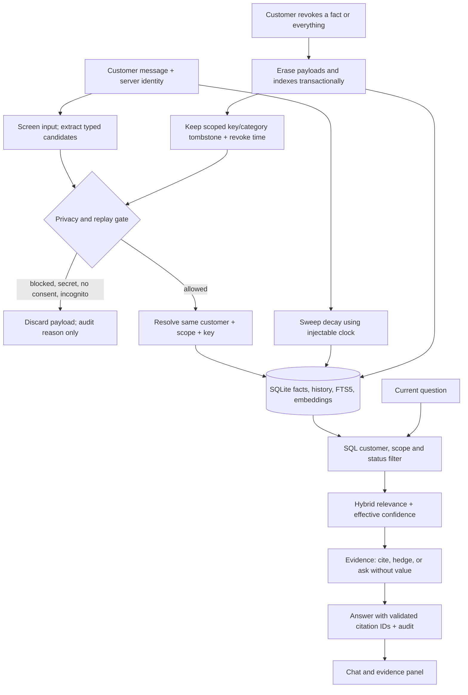

# Memory architecture: write, retrieve, forget

Design contract for stage 03; module names below are planned implementation locations. Doo Assist serves fictional Qamar Home customers. FastAPI supplies a server-issued sandbox customer identity to every operation; Gradio displays the chat, evidence, inspector and privacy controls. The agent coordinates the paths without letting a model choose another customer's identity.

| Path | Modules and behavior |
|---|---|
| Write | `app/llm/client.py` screens messages before extraction; failed screening cannot write. `app/memory/privacy.py` independently enforces secrets, consent, blocked categories and incognito. `write_path.py` resolves contradictions deterministically within customer + scope + key: customer statements beat imports/inferences; newer customer statements supersede older ones; conflicting imports/inferences become contested. Same-value evidence corroborates once per source event. `store.py` commits facts, lineage, FTS5 and audit atomically; embedding failure leaves FTS5 available. |
| Retrieve | `retrieval.py` filters by server identity and authorized customer/current-order/session scope in SQL before search. Superseded and revoked facts are excluded. Hybrid relevance ranks eligible evidence; `confidence.py` uses source confidence, category decay, corroboration and contested penalty from the shared config, without multiplying decay twice. Stale facts require reconfirmation even if their score is high. `evidence.py` supplies quoted source, age, score and ID for assert/hedge facts; below-threshold or contested facts expose only a question about the key, never their value. `app/agent/orchestrator.py` validates answer citation IDs against this evidence and records reads through `audit.py`; it never executes memory text or support actions. |
| Forget | `clock.py` supplies real or session-local demo time. `forgetting.py` sweeps on startup and each request, marks stale records and logs transitions. Revocation erases value, text, source quote, embedding, FTS entry and corresponding retained payloads across that key's history; audits hold event metadata, not fact copies. `store.py` retains only a customer/scope/key/category tombstone and revocation time. Old-message replay is blocked; a fresh explicit customer statement after revocation can restore the fact. Forget-everything applies this to all the customer's scopes. Session facts expire with the session. |

**Storage and boundaries.** SQLite contains facts, source-event metadata, lineage, privacy settings, tombstones and content-free audit events; session facts remain session-local. Embeddings carry their fact ID and customer scope and are optional. Inspector, correction, confirmation, export, reset and forgetting use the same identity-bound store API. Raw chat is not durably retained; revocation also clears affected session chat/evidence caches. Only redacted, authorized evidence reaches the answer model. No secret payload enters storage, logs or embeddings.

**Walk-through.** Layla says “I live in Dubai.” After screening and privacy checks, the write path stores `customer / delivery_city = Dubai`, the exact quote, source event and configured stated confidence. “Which delivery city do you have?” retrieves only Layla's eligible fact, and the reply cites its ID beside the quote and confidence. A time jump past the location half-life makes it stale: the next reply asks for confirmation. “I moved to Abu Dhabi” supersedes Dubai. Revoking `delivery_city` erases both versions' payloads and indexes; a later city question asks Layla, and replaying the old Dubai message cannot restore it.

**References:** [approved plan](../../01_spec/output/execution-plan.md), [model](../../../_shared/memory-model.md), [numeric configuration](../../../_shared/memory-config.json), [policies](../../../_shared/policies.md). These shared files are authoritative over earlier plan examples.
